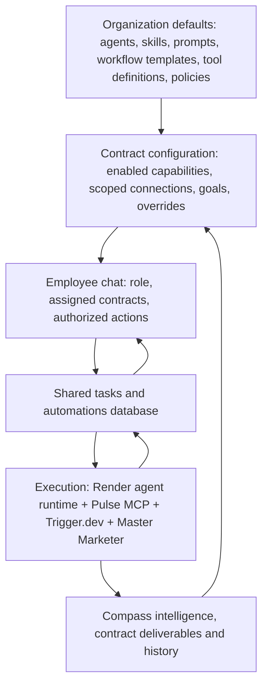

# Ocean — Contract-Centric AI Work Architecture

**Status:** Proposed target architecture / implementation briefing  
**Date:** October 14, 2026  
**Audience:** Codex, Claude Code, engineering leads, and product leadership

## 1. Executive summary: the architectural revelation

**Ocean should extend Compass's existing contract-centric operating model rather than become a separate collection of individually hosted AI agents.** The contract is the primary scope for all client work. Organization-level templates establish defaults; contract-level configurations selectively override them; employees initiate and monitor work through a unified chat, task, and automation experience.

An "agent" does **not** have to be a separate VM, process, or persistent AI identity. In the initial implementation, role, contract, and capability agents can be *composable configurations* (instructions, skills, tools, model preferences, and permitted context) executed by a shared agent runtime. Introduce independently executing agents only where delegation, parallel work, or isolation materially requires them.

**North star:** An employee asks Ocean to perform client work, can leave the chat while a long-running job executes, sees the same task from their personal dashboard and the contract workspace, receives a completion/approval/failure notification, and can schedule the same work to recur.

## 2. Existing systems: preserve and extend

| System | Existing / intended responsibility | Guidance |
|---|---|---|
| Compass | Contract-scoped institutional knowledge, meeting notes, campaign change history, deliverables, RAG, client intelligence, contract settings | Remains system of record; reuse existing contract model |
| Pulse | Existing user-facing application and MCP/tool access to Compass | Extend chat and MCP rather than duplicate retrieval |
| Master Marketer | Specialized marketing skills and complex research/reporting | Retain existing execution logic |
| Trigger.dev | Long-running multi-source workflows (~15 sources / ~15 minutes for some research), scheduling, execution tracking | Continue as background and recurring job engine |
| Render | Existing backend and separate API service repositories | Add lightweight coordination only where needed |
| Supabase / Lovable Cloud | Existing application data, identity and Edge Functions | Account for ongoing migration to company-controlled infrastructure; do not disrupt production |
| Databox | Standardized reporting and configured metrics | Preferred source for canonical KPIs where adequate |
| Google Ads / LinkedIn Ads / other APIs | Detailed platform reporting and eventually authorized actions | Use for granular investigation and approved writes |

**Do not assume a new vendor platform (Hermes, Orgo, Kortix, LibreChat, Open WebUI) is required.** First audit Compass Chat's existing tool-calling capabilities and the cost of extending it. Do not rebuild Master Marketer or the established retrieval pipeline.

## 3. Core architectural principle: organization → contract → employee views

Organization templates should be versioned and inherited dynamically. Contract overrides should target specific configurable fields, **not** copy/fork entire templates by default. Centrally enforced security, audit, and permission rules must not be overridable at contract level.

### Agent terminology

- **Role configuration:** Account Director, Strategist, etc. Defines how the assistant serves an employee across *authorized* contracts.
- **Contract configuration:** One logical AI workspace per contract, containing objectives, instructions, knowledge references, enabled capabilities, integration mappings, and scoped history. Not necessarily a separate running agent.
- **Capability configuration:** Reusable specialists such as Paid Media Analysis, Research, SEO, Content, Reporting, or Social Publishing, with their own skills and allowed tools.
- **Restricted internal configurations:** Finance, HR, executive functions. These should use organization-level/internal scopes and stronger access restrictions rather than artificial client contracts.

A typical request combines **employee role + selected contract + selected capability** into one execution context. Delegate to a second agent only when beneficial. A *skill* is a reusable procedure; an *MCP tool* is an interface to data/actions; a *workflow* is an execution sequence; none inherently requires its own agent or computer.

## 4. Unified employee experience: Chat, Tasks, Automations

### Chat

Employees ask for information or work in a single interface. For fast read-only tool calls, stream tool activity and respond inline. For lengthy operations, create a persistent task and return immediately with a task card, status, and link. **Do not keep a browser request open for a 15-minute Trigger.dev job.**

### Tasks

Every substantive background operation creates a single task record. The same record is visible in two authorized views:

1. **My Tasks:** Tasks launched by, assigned to, or requiring action from the employee across their contracts.
2. **Contract Tasks:** All authorized work performed for that contract, including work initiated by other team members and automations.

Tasks need queued, running, awaiting approval, completed, failed, canceled states; progress events; links to originating conversation; execution IDs; outputs; errors; owner; and audit history. Employees must be able to navigate away and return. Use Supabase Realtime or polling for progress; implement an in-app notification inbox and optional email/push channels.

### Automations

Employees should be able to say, **"Run Acme's paid media analysis every Tuesday at 8 AM and save the result to Compass."** Ocean interprets the request, shows a confirmation with contract, capability, schedule, timezone, permissions, output location and cost/approval policy, then creates a recurring automation backed by Trigger.dev.

Employees can list, edit, pause, resume, run now, and inspect history for their authorized automations. Every scheduled occurrence creates a new task record. Schedules survive chat-session closure. Revalidate authorization and connector access on **every** run; disable jobs when a contract closes or an employee loses access. Persist schedule definitions in an Ocean-owned database rather than only in a third-party chat vendor's scheduler.

## 5. Contract-scoped integration architecture

Separate the **global connector definition** from the **contract-specific authorized connection**:

| Connector | Global definition | Contract-level binding |
|---|---|---|
| Databox | API, metric catalog, reporting conventions | Data source IDs / reporting configuration |
| Google Ads | API/MCP implementation, agency manager access, tool policies | Approved Google Ads customer IDs |
| LinkedIn Ads | Approved Marketing API integration, tool policies | Authorized advertising account IDs |
| HubSpot | OAuth and CRM tools | Authorized portal/account |
| Google Search Console | API and property tools | Approved website properties |
| ClickUp | API/MCP tool definitions | Authorized lists/folders/spaces |
| Other social channels | Publishing/review tools | Authorized pages/accounts |

Agents must not freely select another client's ad account merely because a broad agency credential can technically access it. Pulse MCP/backend must resolve and validate `contract_id`, requesting user, permitted account/resource IDs, action type, and approval policy on every call.

### Databox versus direct API: deterministic routing

Introduce a small **Metric Registry / Data Source Router** in the existing backend. The agent requests the *metric and dimensions*; the backend selects the source based on configured coverage, canonical definitions, granularity, freshness, permissions, quotas, and source priority.

- Standard KPIs: Databox first **when the exact metric/dimensions are supported**.
- Granular analysis (Google search terms, LinkedIn creative/audience breakdowns): direct platform APIs where authorized.
- Contract objectives, historical decisions, deliverables: Compass.
- Complex research: Master Marketer/Trigger.dev.

Return source provenance, time period, timezone, attribution/conversion definitions, and any missing coverage. Never silently combine incompatible metrics or fabricate a fallback. New Databox custom metrics should be proposed for review, not automatically proliferated.

## 6. Execution flow examples

### Interactive analysis

1. Employee selects an authorized contract or Ocean resolves it and confirms ambiguity.
2. Agent runtime composes role + contract + capability instructions and available tools.
3. Agent calls Pulse MCP for permitted performance data and Compass context.
4. Backend routes metrics through Databox or direct platform API.
5. Agent interprets results and returns cited recommendations in chat.

### Long-running research

1. Chat request creates an `ocean_task` linked to employee, contract, capability, and conversation.
2. Backend launches an existing Master Marketer Trigger.dev workflow; stores the run ID.
3. Trigger.dev emits status/progress events; task card and dashboards update.
4. Result is saved as an authorized Compass deliverable with provenance/version.
5. Employee receives a completion notification and can continue in the original chat.

### Consequential actions

An agent may *propose* pausing ads, changing budgets, publishing social posts, or modifying CRM data. Show a concrete diff/preview, affected account, financial impact when relevant, and approval identity. **Execute only after server-side authorization and explicit approval**; log the before/after state and result. Read-only should be the default during rollout.

## 7. Suggested logical data model (map to existing schema first)

- `agent_templates`: Global role/capability definitions and versions.
- `skill_templates`: Shared procedures and published versions.
- `workflow_templates`: Standard workflows and execution parameters.
- `contract_agent_config`: Contract-specific enabled capabilities and field-level overrides.
- `contract_integrations`: Provider, contract, resource IDs, credential reference, connection status.
- `metric_registry`: Metric definitions, dimensions, preferred sources, equivalence/fallback rules.
- `ocean_tasks`: Work identity, owner, contract, initiator, capability, status, run ID, conversation ID, output references.
- `ocean_task_events`: Status transitions, progress, errors, approvals, audit records.
- `ocean_automations`: Owner, contract, workflow/agent reference, schedule, timezone, delivery, approval and policy state.
- `ocean_notifications`: Recipient, task/run reference, event type, read state, delivery status.

Names are illustrative. **Audit existing tables and reuse or extend them; avoid parallel sources of truth.** Keep sensitive secrets in a managed secrets store, not configuration tables or Git.

## 8. Security and governance requirements

- **Contract is the authoritative client-work scope.** Every client-data read/write and execution record must be scoped and authorized server-side.
- Employee role, contract assignment, and capability permissions combine; delegation must never increase access.
- Use explicit execution identity for background jobs and re-check it at run time.
- Keep tenant/client data, credentials, local files, and agent memory isolated; separate agent profiles alone are not a security boundary.
- Record who requested, approved, and executed consequential actions.
- Enforce contract-specific model-provider/data-processing policies; never silently route private-only data to external models.
- Track model/tool/workflow cost by employee, contract, capability, and automation.
- Give technical/analytics leads control over global templates, connectors, and canonical metric definitions. Let employees personalize within approved limits.
- Archive/suspend automations and revoke connector access on contract termination; retain history according to retention rules.

## 9. Rollout sequence: preserve stable production

**Phase 0 — Audit:** Map current Compass Chat agent/tool loops, Pulse MCP authentication, content-template overrides, database schema, Trigger.dev callbacks, and existing integration/account mappings. Document what already works.

**Phase 1 — Task foundation:** Create shared task/event records, background job launch and status callbacks, chat task cards, My Tasks and Contract Tasks views, and notifications. Pilot one existing Master Marketer report.

**Phase 2 — Automation foundation:** Create an Ocean-owned automation registry and self-service schedule/create/pause/resume/list tools. Execute through Trigger.dev; show per-run task history and results.

**Phase 3 — Composable configurations:** Extend global prompts/templates to role, contract, capability and skill definitions with field-level contract overrides and versioning. Avoid one-VM-per-agent designs.

**Phase 4 — Contract integrations and routing:** Add contract-bound Google Ads/LinkedIn Ads/Databox mappings, source router and metric registry. Start read-only; add approval-gated writes after tests.

**Phase 5 — Scale and governance:** Employee onboarding, reusable skill publishing, usage/cost analytics, mobile polish, monitoring, backups, staging/CI/CD and secure model routing.

The application is currently stable but has historically lacked staging. **Establish isolated staging and controlled deployments before major agent or infrastructure changes.** Coordinate this work with the Lovable Cloud-to-independent infrastructure migration without coupling both cutovers.

## 10. Acceptance tests

1. Two employees with different contract assignments cannot access each other's restricted contract data, directly or through delegated agent calls.
2. An employee launches a 15-minute Master Marketer report, closes chat, and later sees progress/completion in My Tasks and the appropriate Contract Tasks view.
3. A second authorized employee sees the same contract task without gaining access to the initiating employee's unrelated personal work.
4. An employee creates a Tuesday 8 AM recurring analysis through chat, confirms it, pauses/resumes it, and sees individual run history.
5. A global Paid Media skill/template update propagates to eligible contracts while preserving explicit, allowed contract overrides.
6. A Google Ads request resolves only the account IDs mapped to the selected contract.
7. A missing Databox metric is retrieved from an approved direct API when semantically equivalent; otherwise the system explains the coverage gap.
8. A proposed campaign-budget change cannot execute without an authorized approval and produces an audit record.
9. An employee's revoked access suspends or blocks subsequent scheduled runs.
10. A failed background job surfaces a clear status, diagnostics, and permitted retry path without losing task history.

## 11. Instructions to Codex / Claude Code

**Treat this document as target-state product requirements, not authorization to modify production.**

1. Inspect the current repositories, schema, Edge Functions, MCP interfaces, and Trigger.dev workflows before designing new components.
2. Produce a **current-state vs. target-state gap analysis** and identify what can be reused.
3. Propose the smallest coherent implementation for Tasks + Automations + contract-scoped configuration inheritance.
4. Specify APIs, database migrations, access-control checks, Trigger.dev integration, frontend surfaces, test plan, and deployment sequence.
5. Clearly distinguish *confirmed existing capabilities* from *proposed additions* and list any unknowns requiring investigation.
6. Do not replace existing Master Marketer, Compass intelligence, or working integrations without a demonstrated need.
7. Do not create or deploy infrastructure, alter credentials, or migrate production data without explicit approval.

### Guiding statement

> **Ocean is where employees request and monitor work. Compass is the authoritative contract intelligence and deliverables system. Pulse MCP supplies authorized tools and data. Master Marketer and Trigger.dev perform complex and scheduled work. Organization-level capabilities are reusable; contract-level configurations tailor them; employee and contract dashboards show the same underlying work.**
